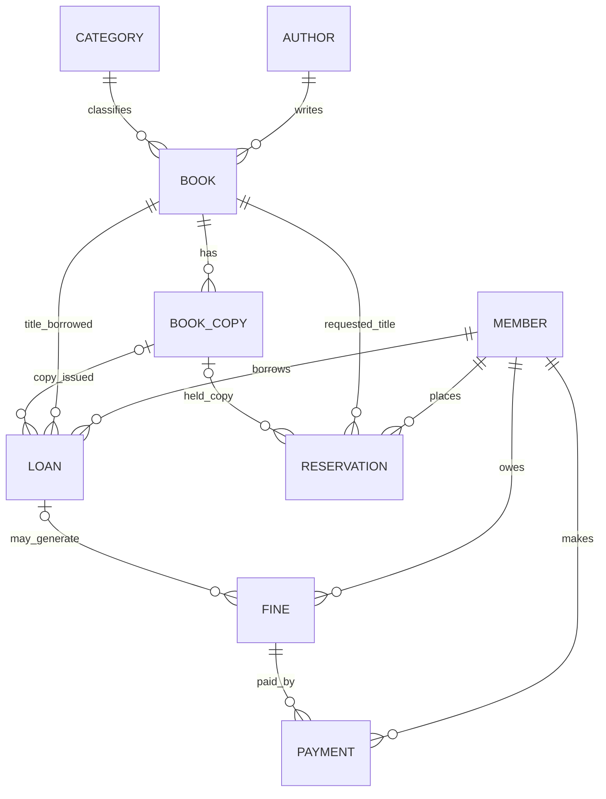

# Kisii University Library Management System
## Resource Modelling

**Course:** COMP 330  
**Project:** Kisii University Library Management System  
**Model basis:** Current project data models and `backend/openapi.yaml`

---

## 1. Purpose and scope

Resource modelling identifies the important information managed by the library, the relationships between that information, and the operations clients can perform through the API. It gives the database, backend, frontend, and API contract a shared design.

The application owns the catalog, member accounts, loans, reservations, fines, payments, and notification queue. The student registry, Google Books, M-Pesa, SMTP/Gmail, SMS provider, and OpenRouter are external systems, not library database resources. MongoDB stores resources as Mongoose documents with `ObjectId` identifiers and references. Persisted models include `createdAt` and `updatedAt` timestamps.

## 2. Resource relationship diagram

**Interpretation:** one author or category can be associated with many books; each book has one author and one category. A member can have many loans, reservations, fines, and payments over time. A loan may reference a specific physical copy; older aggregate-inventory records may have no copy reference. Notifications store the recipient address or phone number rather than a member reference, so no database relationship to `Member` is implied.

`Fine.appliedPaymentIds` records payments applied to a fine. Each payment also identifies its fine with `fineId`, supporting partial payments and payment history.

## 3. Core resources

`id` is the API representation of MongoDB `_id`. All resources below have creation/update timestamps.

### Book — a catalog title, not a physical item

| Field | Type | Constraints / meaning |
|---|---|---|
| `id` | ObjectId | Primary identifier |
| `title` | String | Required; trimmed |
| `authorId` | ObjectId ref | Required; references `Author` |
| `authorName` | String | Denormalized display/search value |
| `categoryId` | ObjectId ref | Required; references `Category` |
| `categoryName` | String | Denormalized display/search value |
| `isbn` | String | Required; unique per title |
| `description` | String | Optional; defaults to empty string |
| `totalCopies` | Number | Required; non-negative inventory count |
| `availableCopies` | Number | Non-negative copies currently available |
| `status` | Enum | `ACTIVE`, `ARCHIVED`; archive preserves history |

Full-text search indexes title, author, category, ISBN, and description. Storing author/category names on a book supports display and search without repeated joins; their IDs retain the relationships.

### BookCopy — one physical copy of a title

| Field | Type | Constraints / meaning |
|---|---|---|
| `id` | ObjectId | Primary identifier |
| `bookId` | ObjectId ref | Required; references `Book` |
| `barcode` | String | Optional; unique when supplied |
| `status` | Enum | `AVAILABLE`, `HELD`, `ON_LOAN`, `DAMAGED`, `LOST`, `WITHDRAWN` |
| `conditionNote` | String | Optional; maximum 500 characters |

Copies are managed individually when copy records exist. Titles with no copy records continue to use aggregate inventory counts. Barcodes may be added when a library labels copies.

### Member — a student, staff member, librarian, or administrator

| Field | Type | Constraints / meaning |
|---|---|---|
| `id` | ObjectId | Primary identifier |
| `fname`, `lname` | String | Required first and last names |
| `email` | String | Required; lowercase; unique |
| `password` | String | Required hash; excluded from normal reads and API responses |
| `phone` | String | Optional contact number |
| `regNo` | String | Optional; uppercase; unique when present |
| `memberType` | Enum | `STUDENT`, `STAFF` |
| `enrollmentStatus` | Enum | `UNVERIFIED`, `VERIFIED`, `INACTIVE` |
| `verifiedAt` | Date | Optional registry verification time |
| `role` | Enum | `MEMBER`, `LIBRARIAN`, `ADMIN` |
| `status` | Enum | `ACTIVE`, `DEACTIVATED` |
| `tokenVersion` | Number | Session-revocation counter |

Public registration always creates a regular `MEMBER`; staff roles require an authorized administrative process. Student borrowing requires verified active enrollment.

### Loan — borrowing transaction and history

| Field | Type | Constraints / meaning |
|---|---|---|
| `id` | ObjectId | Primary identifier |
| `memberId` | ObjectId ref | Required borrower |
| `bookId` | ObjectId ref | Required catalog title |
| `copyId` | ObjectId ref | Optional physical copy |
| `issuedDate` | Date | Required; defaults to current time |
| `dueDate` | Date | Required; normally 14 days after checkout |
| `returnedDate` | Date | Set on return |
| `renewedCount` | Number | Defaults to zero; one renewal maximum |
| `status` | Enum | `ACTIVE`, `OVERDUE`, `RETURNED` |

The borrowing limit is five active/overdue loans per member. Members access their own records; staff can access records for operations.

### Reservation — queue request for an unavailable title

| Field | Type | Constraints / meaning |
|---|---|---|
| `id` | ObjectId | Primary identifier |
| `memberId` | ObjectId ref | Required requesting member |
| `bookId` | ObjectId ref | Required requested title |
| `copyId` | ObjectId ref | Optional physical copy placed on hold |
| `activeKey` | String | Internal uniqueness key for active member/title request |
| `status` | Enum | `WAITING`, `READY`, `FULFILLED`, `CANCELLED`, `EXPIRED` |
| `queuePosition` | Number | Optional waiting-list position |
| `readyAt`, `expiresAt` | Date | Hold start and expiration |

Reservations are for unavailable titles. When a copy becomes available, the next member receives a two-day hold. A member cannot have duplicate active reservations for one title.

### Fine — amount owed by a member

| Field | Type | Constraints / meaning |
|---|---|---|
| `id` | ObjectId | Primary identifier |
| `memberId` | ObjectId ref | Required person who owes the fine |
| `loanId` | ObjectId ref | Optional related loan |
| `amount` | Number | Required; non-negative |
| `paidAmount` | Number | Paid so far; defaults to zero |
| `appliedPaymentIds` | ObjectId ref[] | Payments applied to this fine |
| `reason` | Enum | `OVERDUE`, `DAMAGE`, `OTHER` |
| `status` | Enum | `OUTSTANDING`, `PARTIALLY_PAID`, `PAID` |
| `description` | String | Optional; maximum 500 characters |
| `damage` | Boolean | Damage indicator; defaults to false |

The overdue rate is configured through `OVERDUE_FINE_PER_DAY` (KSh 10 by default). A unique partial index prevents duplicate overdue fines for the same loan.

### Payment — provider payment attempt and result

| Field | Type | Constraints / meaning |
|---|---|---|
| `id` | ObjectId | Primary identifier |
| `memberId` | ObjectId ref | Required paying member |
| `fineId` | ObjectId ref | Required fine being paid |
| `provider` | Enum | Currently `MPESA` |
| `amount` | Number | Required; at least one unit |
| `phoneNumber` | String | Required payment phone |
| `idempotencyKey` | String | Optional unique retry key |
| `providerRequestId` | String | Optional unique provider request ID |
| `providerReceipt` | String | Optional unique provider receipt |
| `status` | Enum | `PENDING`, `SUCCEEDED`, `FAILED` |
| `failureReason` | String | Optional provider failure detail |
| `completedAt` | Date | Set when payment completes |

The provider callback records the payment result. Successful amounts are applied to the fine; failed attempts remain recorded for audit.

## 4. Supporting resources

### Author and Category

Catalog lookup resources. Each contains a unique, required `name`: up to 120 characters for an author, 80 for a category. Each book references one of each.

### Notification

An outbound message and its delivery/retry state.

| Field | Type | Meaning |
|---|---|---|
| `id` | ObjectId | Primary identifier |
| `channel` | Enum | `EMAIL` or `SMS` |
| `eventType` | String | Trigger, such as checkout or reservation |
| `recipient` | String | Email address or phone number |
| `subject` | String | Optional email subject |
| `body` | String | Required message |
| `status` | Enum | `PENDING`, `PROCESSING`, `SENT`, `FAILED` |
| `attemptCount` | Number | Delivery retry count |
| `nextAttemptAt` | Date | Next eligible attempt |
| `lastError` | String | Optional latest delivery error |
| `sentAt` | Date | Successful delivery time |

The destination is stored with the notification so delivery history remains meaningful if a member later changes contact information.

### AI and external service operations

AI search, recommendations, categorization, and chat are API operations, not persisted domain entities. Chat is stateless and is not given live member, loan, fine, inventory, or policy data. Registry and ISBN checks are also operations; verification results are stored on the member, while ISBN lookup can supply catalog metadata.

## 5. Business rules and resource lifecycles

1. **Catalog setup:** create an author and category, then a book title. Physical copy records can be added with or without barcodes.
2. **Checkout:** an active member borrows an available title. The system allocates an available copy if copies are managed; otherwise it decrements aggregate availability.
3. **Return:** mark the loan `RETURNED`, release its copy if present, record an overdue fine if applicable, then offer the copy to the reservation queue.
4. **Renewal:** renew an eligible active loan once, before its due date, only if no active reservation queue exists for that title.
5. **Reservation:** queue a member for an unavailable title. When a copy is held, the reservation becomes `READY`; its hold expires after two days.
6. **Payment:** record a payment attempt, then update payment/fine balances from verified provider confirmation.
7. **Preserve history:** archive books and deactivate accounts rather than deleting records referenced by circulation history.
8. **Enforce ownership:** members access their own protected data; staff operations require the appropriate role. Public registration never grants staff privileges.

## 6. API resource map

All resource endpoints are under `/v1`. The complete contract, request/response definitions, and security schemes are in `backend/openapi.yaml`.

| Resource | Collection operations | Individual / action operations |
|---|---|---|
| Books | `GET /books`, `POST /books` | `GET /books/{id}`, `PUT /books/{id}`, `DELETE /books/{id}` |
| Copies | `GET /books/{id}/copies`, `POST /books/{id}/copies` | `PATCH /books/copies/{copyId}` |
| Authors | `GET /authors`, `POST /authors` | `GET /authors/{id}` |
| Categories | `GET /categories`, `POST /categories` | `GET /categories/{id}` |
| Members | `GET /members`, `POST /members` | `GET /members/{id}`, `PUT /members/{id}`, `PATCH /members/{id}/deactivate`, `GET /members/{id}/loans` |
| Authentication | `POST /auth/register`, `POST /auth/login`, `POST /auth/logout` | `GET /auth/me` |
| Loans | `GET /loans`, `POST /loans` | `GET /loans/{id}`, `POST /loans/{id}/return`, `POST /loans/{id}/renew` |
| Reservations | `GET /reservations`, `POST /reservations` | `GET /reservations/{id}`, `POST /reservations/{id}/cancel` |
| Fines | `GET /fines`, `POST /fines` (calculate from loan) | `GET /fines/{id}` |
| Payments | `GET /payments` | `POST /payments/mpesa/initiate`, provider callback `/payments/mpesa/callback` |
| Notifications | `GET /notifications` | `POST /notifications/email`, `POST /notifications/sms` |
| External services | — | `GET /external/students/{regNo}/verify`, `GET /external/isbn/{isbn}` |
| AI services | — | `GET /ai/search`, `GET /ai/recommendations/{memberId}`, `GET /ai/forecast/demand`, `POST /ai/categorize`, `POST /ai/chat` |

Protected routes accept the session cookie or a bearer JWT; access is further scoped by member ownership and role.

## 7. Data integrity and design decisions

- **Stable identifiers:** MongoDB ObjectIds identify resources; references connect related documents.
- **Uniqueness:** ISBN, email, supplied barcode, author name, and category name are unique. Registration numbers and payment provider identifiers are unique when supplied.
- **Indexes:** frequently queried relationships and states are indexed, including book text search, loan member/status, reservation queues, and notification retry state.
- **Optional physical copies:** aggregate inventory remains supported; copy-level circulation is available when copy records exist. A barcode is optional, but a provided barcode must be unique.
- **Auditability:** archival/deactivation and terminal statuses preserve records needed for history and reporting.
- **Privacy:** password hashes and provider credentials are not public resource fields. Secrets belong in environment configuration, never API responses or source control.
- **Concurrency:** circulation uses guarded updates and compensating operations. High-concurrency inventory/payment deployments should use MongoDB replica-set transactions and operational monitoring.

## 8. Scope and implementation notes

- Authentication currently uses JWTs in an HTTP-only cookie and supports bearer tokens. OAuth 2.0 and standalone API-key authentication are not implemented.
- AI, registry, ISBN, M-Pesa, email, and SMS integrations require valid provider credentials and configuration.
- Container deployment configuration is provided, but a public API, real registry credentials, production monitoring, and hosting access require authorized operators.
- The OpenAPI specification is the contract source of truth. Contract changes should be reflected in the spec, backend, tests, and frontend together.

## 9. Short presentation guide

### Opening

> “Our resource model starts with the catalog and its members. A book represents a title, while a book copy represents one physical item. That distinction lets the system support both quantity-based inventory and copy-level circulation.”

### Walk-through

1. Show **Author → Book ← Category** and explain catalog relationships.
2. Distinguish **Book** from **BookCopy**; mention that barcode is optional.
3. Follow **Member → Loan → Book/BookCopy** to explain checkout and return.
4. Show the **Reservation** queue and two-day ready hold.
5. Follow **Loan → Fine → Payment** to explain overdue charges and M-Pesa confirmation.
6. Finish with notifications and external/AI services; point out that providers are outside the core database.

### Closing

> “The model preserves circulation history, scopes private data to its owner, and uses the API contract as the source of truth for all clients.”

## 10. Questions to be ready for

- **Why have both Book and BookCopy?** A book is the shared catalog description; a copy has its own circulation state.
- **Why is barcode optional?** Some libraries track quantities before labeling every physical copy.
- **Why keep returned loans?** Loan history supports member history, fines, reporting, and audit.
- **Why store author/category names and IDs?** IDs preserve relationships; names support efficient display and full-text search.
- **How are duplicate active reservations prevented?** A unique active key and guarded state updates enforce one active member/title reservation.
- **What is the security boundary?** Members see their own sensitive records; staff operations require authorized roles; public registration creates only regular members.
- **What remains outside the software model?** Public hosting, provider credentials, production backup/restore verification, monitoring, weekly team reports/meetings, milestone assessments, and the final presentation.